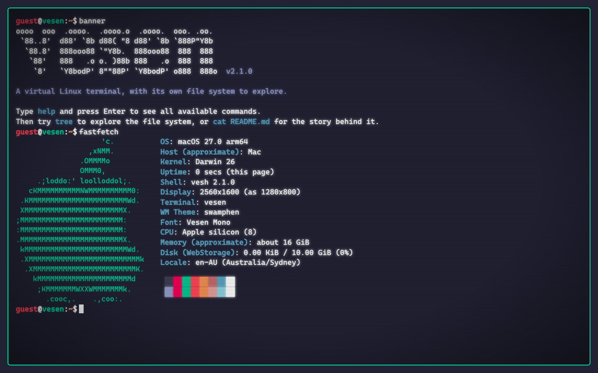
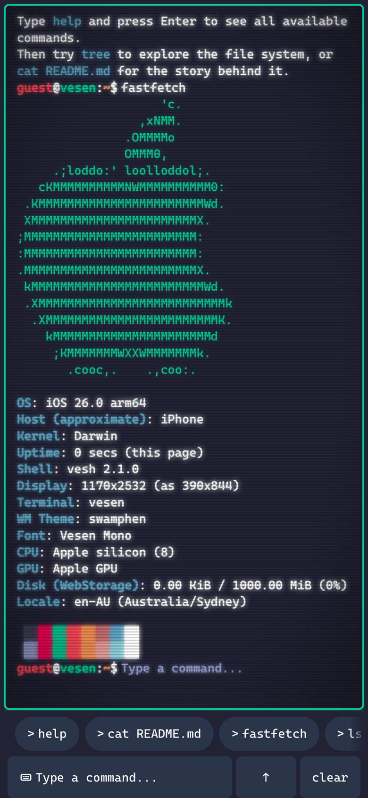
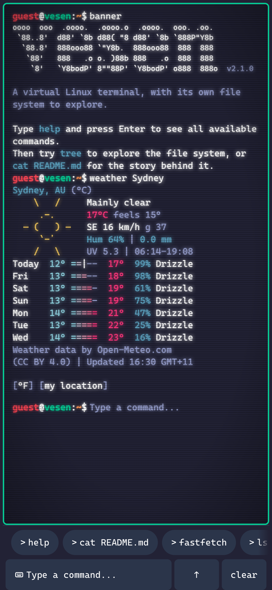
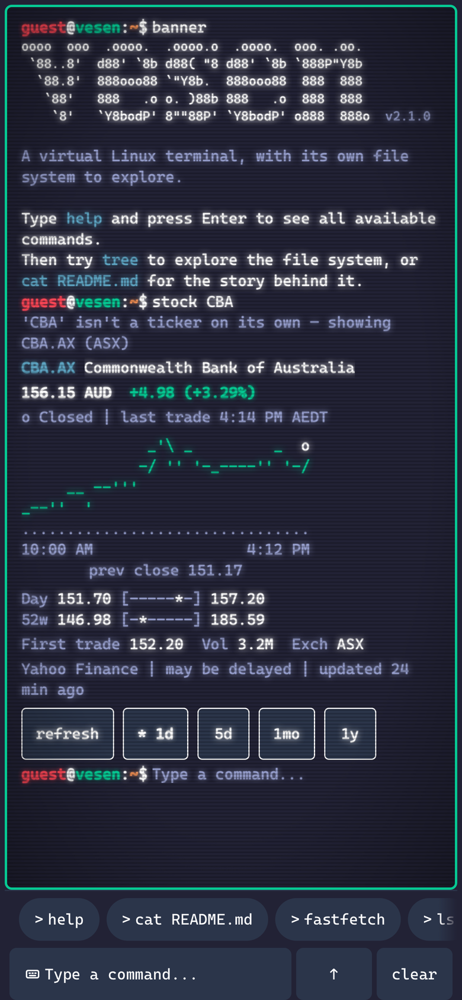
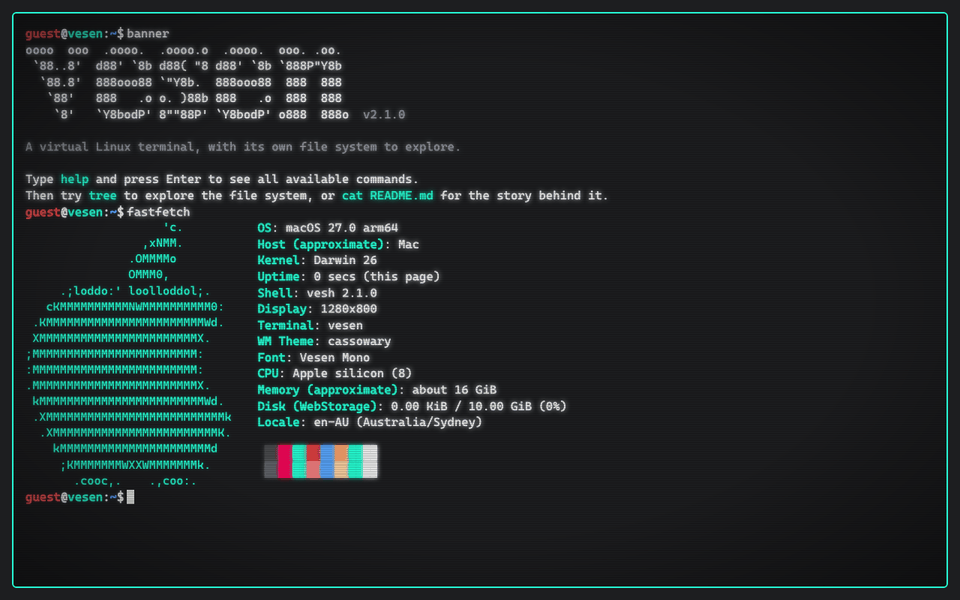

<div align="center">

<pre>
oooo  ooo  .oooo.  .oooo.o  .oooo.  ooo. .oo. 
 `88..8'  d88' `8b d88( "8 d88' `8b `888P"Y8b 
  `88.8'  888ooo88 `"Y8b.  888ooo88  888  888 
   `88'   888   .o o. )88b 888   .o  888  888 
    `8'   `Y8bodP' 8""88P' `Y8bodP' o888  888o
</pre>

**A Linux terminal in your browser, made as much for a phone inside Instagram as for a desktop.**

[**Open www.vesen.app**](https://www.vesen.app) &nbsp;·&nbsp; [Changelog](docs/CHANGELOG.md) &nbsp;·&nbsp; [The shell](docs/SHELL.md) &nbsp;·&nbsp; [Architecture](docs/adr/0001-architecture.md)

[](https://github.com/hsalvesen/vesen/actions/workflows/ci.yml)
[](https://github.com/hsalvesen/vesen/releases)
[](LICENSE)



</div>

## What it is

vesen is Has Salvesen's portfolio, in the shape of a Linux terminal. Everything runs in the page: no server answers your commands.

<table>
<tr>
<td width="50%" valign="top">

**A real shell**<br>
Quotes, pipes that stream, redirection, variables, `$( )` and `$(( ))`, globs, history expansion, aliases, exit codes, and ^C that stops anything. [docs/SHELL.md](docs/SHELL.md) says where it differs from bash.

</td>
<td width="50%" valign="top">

**A file system**<br>
`/home/guest` is yours, with permissions, symlinks, `/proc` and `/dev`, and what you change under `~` is still there when you come back. `/home/has` holds the owner's documents.

</td>
</tr>
<tr>
<td width="50%" valign="top">

**About 150 commands**<br>
Text tools (`grep`, `sed`, `sort`, `diff`, `bc`), file tools (`find`, `tree`, `chmod`), system tools (`ps`, `top`, `uname`), network tools that say what a browser can and cannot do (`dig`, `ping`, `whois`), a pager and an editor (`less`, `man`, `nano`), and some fun (`cowsay`, `fortune`, `cmatrix`).

</td>
<td width="50%" valign="top">

**Live cards**<br>
`weather` draws a forecast, `stock` a quote with its chart and `qr` a code you can scan, each with chips to tap; `whoami`, `about` and `contact` give link cards with Copy.

</td>
</tr>
<tr>
<td width="50%" valign="top">

**Fifteen themes**<br>
Named for Australian animals and each checked for contrast, with an optional CRT over the lot: scanlines, a rolling sweep, a phosphor glow.

</td>
<td width="50%" valign="top">

**Made for a phone**<br>
A dock of chips and keys above the keyboard, a page that fits the screen and never scrolls sideways, and links that keep working inside Instagram's browser.

</td>
</tr>
</table>

## A short tour

```bash
help                      # every command, by category; ls --help (or -h) or man ls says what one does
cat README.md             # the owner's README, in colour
ls -la ~ | grep bash      # pipes, options and globs work as on Linux
fastfetch                 # this device, as a terminal sees it
weather Sydney            # a forecast card; weather --here uses this device's location
stock AAPL CBA.AX         # quotes in a table; stock CBA draws a card with a chart
qr https://www.vesen.app  # a scannable QR card; tap it to present it full screen
dig vesen.app +short      # DNS over HTTPS, and it says so
man ls | less             # the pager; nano notes.txt is the editor
fortune | cowsay          # the fun ones are under Fun: help fun
theme ls                  # every theme with its colours; theme wombat switches
privacy                   # every service a command talks to, and what it is sent
```

### Keys

At the prompt, Tab completes (extend, then list, then cycle), ↑ and ↓ step through the history lines that start with what is typed, Ctrl+R searches the history, and grey text offers the rest of a past line (→ takes it). The readline keys edit the line while the prompt has focus: Ctrl+A, E, U, K, Y, L and D everywhere, Ctrl+W, P, N, F, B and T on a Mac, and Alt+B, F, D, Y, . and Backspace. Ctrl+C stops the running command or abandons the line; on Windows and Linux, with text selected, it copies instead. Escape then a key is that key with Alt, as in readline, and Escape then Tab leaves the terminal for the rest of the page. `help keys` lists them all.

## On a phone

<p align="center">
  &nbsp;
  &nbsp;
  
</p>

A dock rides above the keyboard. Its chips run a starter command in one tap without opening the keyboard, offer what comes next after a command (every theme after `theme ls`), and build a line by tapping. Holding a chip puts it at the prompt instead of running it. The key bar has tab, ↑, ↓, ^C, clear, `...` for symbols and a chevron to put the keyboard away; holding ↑ opens a list of past commands. A hardware keyboard hides the key bar, and `keys on|off|auto` chooses. Open the page with `?dock=1` to see the dock on a desktop.

The page keeps pinch zoom, sizes itself to the visible screen above the keyboard, and never scrolls sideways: wide output such as `ps aux` scrolls inside its own block. Inside Instagram's browser a link opens only when tapped, in the same view, and Back brings the terminal back as it was. The CRT effect is lighter on phones, in in-app browsers and under reduced motion (nothing in it moves there), and off under more contrast, reduced transparency or forced colours.

## Themes

<p align="center">
  
</p>

[docs/themes](docs/themes) has a screenshot of each, or run `theme ls`. `cathode ls` shows the CRT modes, and `cathode quality auto|full|lite|off` overrides the device's choice.

## Network commands are honest

A browser tab cannot send ICMP or raw DNS, so vesen does what a page can and labels it.

| You type | What a tab does instead |
|:--|:--|
| `dig`, `host`, `nslookup` | Asks Cloudflare's DNS over HTTPS, or Google's when Cloudflare cannot be reached |
| `whois` | Asks the registries over RDAP |
| `ping` | Times HTTPS round trips, with ping's statistics at the end or on ^C |
| `ip addr`, `ifconfig` | Shows a synthetic `eth0`, marked as such, and your public address after saying it will ask Cloudflare |
| `wget`, `curl` | Downloads what CORS allows |
| `git log` in `~/projects/vesen` | Reads this repository's newest commits from GitHub |
| `ssh`, `telnet`, `nc`, `ftp`, `traceroute` | Says in one line why a tab cannot be them |

## Stock quotes

`stock AAPL` shows a card with the price in the instrument's currency, the change, the market's phase, a chart and the day and 52-week ranges; several tickers give a table, `stock -s commonwealth bank` searches by name, and `stock -r 5d AAPL` changes the range. Quotes may be delayed, every card says where its data came from and how old it is, and the last good quote is shown marked STALE when live data cannot be reached. Not investment advice.

A browser cannot ask Yahoo Finance for a quote itself (no CORS, and browser-like requests are rate-limited), so quotes come through vesen-stock, a small Cloudflare Worker in [`worker/stock`](worker/stock/README.md):

```text
┌──────────────────────── the page ────────────────────────┐
│ stock CBA                                                │
└────────────┬────────────────────────────────▲────────────┘
   /v1/quote │                                │ one shape from every source
┌────────────▼───────── vesen-stock ──────────┴────────────┐
│ a Cloudflare Worker on the free plan, with rate limits   │
│ CBA → CBA.AX, apple → AAPL                               │
│ a quote cached 60 s, or 300 s while its market is closed │
│ a stale copy, up to 24 h old, when every source fails    │
└────────────┬────────────────────────────────┬────────────┘
       first │                                │ when Yahoo is down
┌────────────▼────────────┐      ┌────────────▼────────────┐
│ Yahoo Finance           │      │ Cboe                    │
│ chart and search        │      │ delayed US quotes       │
└─────────────────────────┘      └─────────────────────────┘
```

Until it is deployed, a build reads Yahoo through a public proxy, which is often down, and `stock` says so. The Worker's README sets it up in five steps: a free Cloudflare account, an API token, two repository secrets, one workflow run and one repository variable.

## How it is built

```text
                    keys and taps
                          │
┌─────────────────────────▼─── src/ui ─────────────────────────────┐
│ the prompt and its editor · transcript · dock · cards · apps     │
└─────────────────────────┬───────────────────────────▲────────────┘
                   a line │                           │ typed blocks, never HTML
┌─────────────────────────▼─ src/shell ───────────────┴────────────┐
│ lexer → parser → expansion → executor, pipes and redirections    │
│ the registry, help and man from the specs, Tab and the chips     │
└──────────┬──────────────────────┬──────────────────────┬─────────┘
           │                      │                      │
┌──────────▼─────────┐ ┌──────────▼─────────┐ ┌──────────▼─────────┐
│ src/commands       │ │ src/vfs            │ │ src/services       │
│ a spec a command,  │ │ /home /proc /dev,  │ │ net and storage,   │
│ bodies load on use │ │ your ~ kept here   │ │ weather and quotes │
└────────────────────┘ └────────────────────┘ └────────────────────┘
```

The app is a DOM-free shell kernel with a Svelte interface on top. [ADR 0001](docs/adr/0001-architecture.md) records the shared contracts and every amendment made while building them; [docs/plan](docs/plan) holds the audit and the plan this version was built from, and [docs/plan/STATUS.md](docs/plan/STATUS.md) what was done, how it differs from the plan, and what is left.

- **Composition root.** `src/main.ts` calls `src/app/bootstrap.ts`, the only place concrete services are built: storage and its migrations, the theme and CRT, the host redirect, the stale-chunk reload, then the shell.
- **The kernel** (`src/shell`): one lexer that never throws, a parser, word expansion, an executor with concurrent pipes and redirections, option parsing, the command registry, help and `man` generated from the specs, the completion engine (`complete/`) and the line editor's pure parts (`editor/`).
- **Commands** (`src/commands`): one `CommandSpec` per file, declared with `defineCommand`. The spec drives running, options, `--help`, `man`, Tab completion and the phone's chips. Long help and heavy bodies sit in a `<name>.run.ts` that loads on first use. Core commands load with the kernel; the rest are a catalogue in `src/commands/more` that loads in one chunk once the page is idle, or as soon as a name the kernel lacks is typed.
- **Output** (`src/output`): commands write text with a small SGR subset, or typed blocks (`lines`, `grid`, `table`, `art`, `panel`, `chips`, `card`, `columns`, `component`), never HTML. `src/ui/OutputView.svelte` draws them with text interpolation only, and tap actions come only from the trusted `out` builders.
- **The file system** (`src/vfs`): permissions, symlinks, `/proc` and `/dev`, a 512 KB quota, and an overlay of your changes under `~` saved in the browser.
- **Services and platform** (`src/services`, `src/platform`): the only code that touches browser APIs. The network service gives every request a deadline and typed errors; storage falls back to memory when the browser blocks it; the opener holds the in-app link policy.
- **Interface** (`src/ui`): the transcript, the prompt and its editor, the phone dock, the rich cards (loaded on first use) and the full-screen apps (`AppHost` with the pager, editor, QR presenter, rain and sudo's show).

`npm run check:boundaries` keeps `src/shell`, `src/output`, `src/vfs`, `src/lib` and `src/commands` free of the DOM, and `npm run check:bundle` holds the budgets: 60 kB gzip of JavaScript before the first paint, 75 kB for the kernel (in at most four files), 40 kB for the catalogue's specs.

## Project structure

```text
src/
├── main.ts, App.svelte, app.css   # Entry: bootstrap, then the app shell; boot errors shown plainly
├── themes.json                    # The fifteen themes: palettes and any role colours a theme sets
├── app/                           # bootstrap.ts (composition root), shell.ts (builds the shell and its
│                                  # services), lazy-shell.ts (loads the kernel), transcript.ts
├── shell/                         # The DOM-free kernel: lexer, parser, expand, glob, histexpand,
│   │                              # alias, arith, executor, streams, flags, registry, help, keys,
│   │                              # session, prompt, reader; types.ts holds the contracts
│   ├── complete/                  # Tab, the ghost text and the chips, all from the specs
│   └── editor/                    # Readline operations, the kill ring, the key table, history search
├── commands/                      # One CommandSpec per file (docs/ADDING_COMMANDS.md)
│   ├── portfolio/ files/ text/    # The core, loaded with the kernel: theme, cathode, banner, whoami,
│   ├── shell/ system/ network/    # qr, ls, cat, cd, help, man, alias, date, weather, stock, curl...
│   ├── more/                      # The catalogue, loaded after the kernel: text/, files/, shell/,
│   │                              # system/, network/, fun/, editor/
│   └── lib/                       # What commands share: the regex guard, text input, file errors,
│                                  # wildcards, the process table, DNS over HTTPS, tables, art
├── output/                        # Spans, blocks and the `out` builders; plain text; the SGR reader;
│                                  # the {colour} markup of the owner's documents
├── vfs/                           # The file system, its seed (/home, /etc, /proc, /dev, /usr/bin),
│                                  # persistence and identity (guest@vesen)
├── content/                       # The owner's documents in {colour} markup
├── lib/                           # Framework-free: qr/ (the QR encoder and renderers), colour and
│                                  # roles (contrast), pager and nano models, md5, system names
├── services/                      # Browser-facing: net, storage and storage-keys, opener, clipboard,
│                                  # bell, clock, sysinfo, digest, session snapshot, weather/, market/
├── platform/                      # Device and in-app detection, viewport, input scale, head tags,
│                                  # theme application, CRT tier, geolocation, stale-chunk reload
├── stores/                        # Svelte stores: screen, term, theme, cathode, prefs, viewport
├── styles/                        # tokens.css (Vesen Mono, sizes), terminal, shell, components, crt
├── interfaces/                    # The theme type
├── testing/                       # Test setup, stand-in commands and fakes
└── ui/                            # Transcript, OutputView, RichBlock, SpanView, StatusLine, AppHost
    ├── prompt/                    # The prompt controller, LineEditor and PromptLine
    ├── dock/                      # The phone dock: chips, key bar, history sheet
    ├── components/                # Cards, each loaded on first use: link, weather, quote, QR
    ├── apps/                      # Full-screen apps: Pager, Editor, QrPresenter, Matrix, Rick, Shutdown
    └── actions/                   # The one scroll owner, and the focus policy
public/                            # 404.html, fonts/ (Vesen Mono and OFL.txt), icons/, og.png,
                                   # audio/, manifest.webmanifest, probe/ (the device probe, not linked)
assets-src/fonts/                  # The source Vesen Mono is built from (not served)
worker/stock/                      # vesen-stock, the Cloudflare Worker for quotes (its own README)
tests/                             # The command harness, transcripts, XSS tests, hosting checks,
                                   # recorded network fixtures
e2e/                               # Playwright: desktop Chrome, iPhone in Instagram (WebKit), Pixel 7
scripts/                           # The checks (boundaries, bundle, contrast), the kernel chunk rule,
                                   # the boot script plugin, icons, og image, screenshots, fonts/, art
config/                            # The strict TypeScript configs that npm run check:strict runs
docs/                              # CHANGELOG.md, adr/, plan/ (with STATUS.md), themes/, images/,
                                   # SHELL.md, ADDING_COMMANDS.md
.github/                           # CI, release and stock Worker workflows; issue forms; PR template;
                                   # CONTRIBUTING, SECURITY and the code of conduct
```

The root keeps only what its tools look for there: `package.json` and its lockfile, `index.html` and `vite.config.ts` (Vite), `svelte.config.js`, `tsconfig.json`, `playwright.config.ts`, `firebase.json` and `.firebaserc` (Firebase), `.nvmrc`, `.env.example`, the README and the licence.

## Development

Node 22.12 or later (`nvm use` reads `.nvmrc`).

```bash
npm ci                     # install exactly what package-lock.json names
npm run dev                # development server on http://localhost:3000
npm run build              # production build into dist/
npm run preview            # serve the production build
npm run check              # svelte-check, 0 errors
npm run check:strict       # strict TypeScript: the browser code with no Node types, then tests,
                           # scripts and config with them
npm run check:boundaries   # DOM-free folders stay DOM-free, no {@html}, the catalogue stays out of
                           # the kernel, the deleted legacy layer stays deleted
npm test                   # unit tests (Vitest, node and happy-dom)
npm run check:bundle       # after build: initial JS 60 kB, kernel 75 kB, catalogue 40 kB, stock's
                           # first quote 19 kB (gzip)
npm run check:contrast     # WCAG contrast of every theme; add -- --strict to fail on any role
                           # below its minimum, as CI does
npm run test:smoke         # the @smoke Playwright tests on every project, as CI runs them
npm run test:e2e           # every Playwright test
```

Install the Playwright browsers once with `npx playwright install chromium webkit`. `PW_PORT` chooses the port Playwright's preview server uses. `npm run build && node scripts/theme-screenshots.mjs` regenerates the theme screenshots and `themes.gif`, with ffmpeg or, where it is missing, `scripts/gif.py` (Python with Pillow and numpy).

## Configuration

Vite reads two variables at build time. Copy [.env.example](.env.example) to `.env.local` (ignored by git) to set them locally; CI reads the repository variables of the same names.

| Variable | What it is | When empty |
|:--|:--|:--|
| `VITE_STOCK_API` | The stock Worker's base URL, such as `https://vesen-stock.<subdomain>.workers.dev` | `stock` reads Yahoo's chart through a public proxy, which is slower, often down, and says so |
| `VITE_FETCH_PROXY` | vesen's own fetch proxy for `curl --via-proxy` | `curl --via-proxy` says the site has none |

## Deployment

[`.github/workflows/ci.yml`](.github/workflows/ci.yml) runs every gate on each pull request and each push to `main`: svelte-check, strict types, boundaries, unit tests, the build, the bundle budgets, contrast and the Playwright smoke tests (Chromium and WebKit). The build it tested is the one deployed to Firebase Hosting:

- a pull request from this repository gets a **preview channel**, and the bot comments its URL on the pull request;
- a push to `main` deploys to the **live channel**, www.vesen.app.

`firebase.json` sets the Content-Security-Policy and the other security headers, never caches `index.html` and caches hashed assets for a year. Pushing a `v*` tag runs `release.yml`, which creates the GitHub release; `.github/workflows/stock-worker.yml` deploys the stock Worker when it changes and checks it daily.

## Contributing

[CONTRIBUTING.md](.github/CONTRIBUTING.md) covers setup, the gates and the pull request flow, and [docs/ADDING_COMMANDS.md](docs/ADDING_COMMANDS.md) how to add a command. Please report security problems privately, as [SECURITY.md](.github/SECURITY.md) describes.

## Credits

- Weather data by [Open-Meteo.com](https://open-meteo.com/), under [CC BY 4.0](https://creativecommons.org/licenses/by/4.0/).
- Place names © [OpenStreetMap](https://www.openstreetmap.org/copyright) contributors, under the [ODbL](https://opendatacommons.org/licenses/odbl/).
- The terminal font, Vesen Mono (`public/fonts/VesenMono.woff2`), is a modified subset of Cascadia Code, distributed under the SIL Open Font License 1.1 under its own name: see [public/fonts/OFL.txt](public/fonts/OFL.txt).

`privacy` in the terminal lists every service a command talks to and what it sends.

## Licence

MIT: see [LICENSE](LICENSE).

<div align="center">

**Has Salvesen** &nbsp;·&nbsp; [vesen.app](https://www.vesen.app) &nbsp;·&nbsp; [GitHub](https://github.com/hsalvesen) &nbsp;·&nbsp; [LinkedIn](https://www.linkedin.com/in/harrysalvesen/)

</div>
